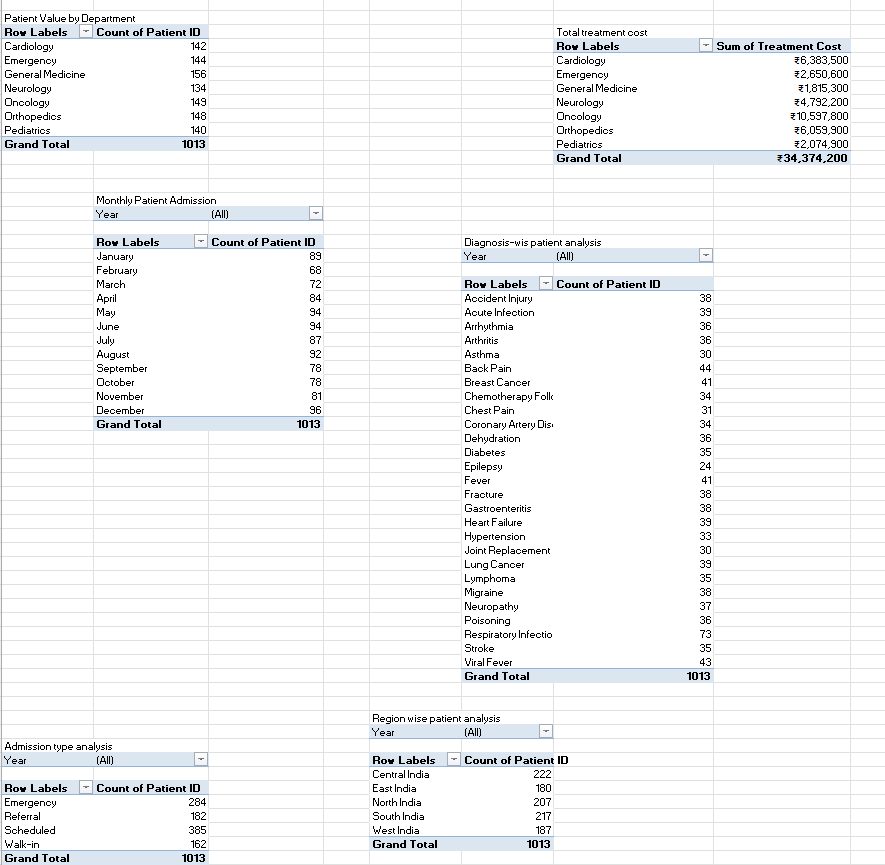

# Hospital-Operations-Analytics-Dashboard

## Project Overview
This project focuses on analysing hospital operational data and presenting key information through an interactive dashboard built using Microsoft Excel.

The dashboard helps explore patient activity, treatment costs, department performance, admission patterns and other operational trends through visual reports and interactive filters.

## Project Objectives
- Analyse patient records and hospital operational data.
- Monitor patient volume and treatment costs.
- Compare department-wise patient activity and treatment expenses.
- Explore monthly and regional admission patterns.
- Provide an interactive dashboard for easier data analysis.

## Tools & Skills Used
- Microsoft Excel
- PivotTables
- Excel Charts
- Slicers
- Data Analysis
- KPI Reporting
- Dashboard Development

## Dataset
The project uses a **synthetic practice dataset containing 1,013 patient records**.

The dataset includes:
- Date and year
- Patient ID
- Department
- Doctor
- Diagnosis
- Admission type
- Region
- Payment method
- Treatment cost

 ##Note: This is a fictional practice dataset. It does not contain real patient or medical information.

## Key Performance Indicators (KPIs)
The dashboard includes the following key metrics:
- Total Patients
- Total Treatment Cost
- Average Treatment Cost
- Total Departments

## Dashboard Analysis
The project includes visual analysis of:

1. Treatment Cost by Department
2. Patients by Department
3. Monthly Admissions
4. Region-wise Admissions
5. Diagnosis Distribution
6. Admission Type

A separate Department Analysis sheet provides additional department-level visualisations.

## Interactive Features
The dashboard includes slicers to filter the analysis by:
- Year
- Department
- Region
- Admission Type
- Doctor
- Month
- Diagnosis
- Payment Method

These filters allow users to explore different aspects of the hospital dataset interactively.

## Project Outcome
Developed an interactive Excel dashboard to organise and analyse hospital operational data, monitor key performance indicators, and explore patient and treatment-cost patterns through visual reporting.

## Project Files
- Excel workbook: Hospital Operations Dashboard
- Dashboard screenshots
- Department Analysis screenshots

---

**Created as an academic portfolio project as part of my MBA Healthcare Management learning journey.**
## Dashboard Preview

### Hospital Operations Dashboard

### Department Analysis

